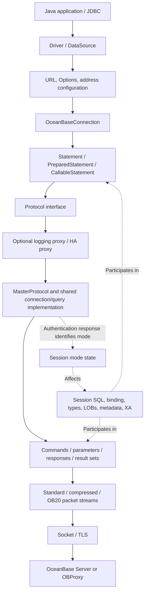

# OBConnector/J source structure and feature outline

This document maps the Java driver's actual structure, features and compatibility-mode branches as input to the OceanBase Go driver design. Module IDs are logical reading/discussion groups, not a claim that the Java source isolates those modules completely.

## 1. Analysis baseline and terminology

| Item | Baseline |
| --- | --- |
| Analysis date | 2026-10-16 |
| Java source repository | [oceanbase/obconnector-j](https://github.com/oceanbase/obconnector-j) |
| Java branch | `master` |
| Java commit | `6adc311ba5db8b2f19f98f3e6e4734667fdfdda1`, message `push v2.4.14` |
| Maven coordinates | `com.oceanbase:oceanbase-client:2.4.14` |
| Public specification | JDBC 4.2, Java 8 compilation target |
| Source lineage | README identifies MariaDB Connector/J as the origin, extended with OceanBase protocol support and improvements |
| Deliverable | Source analysis in this Go repository's docs directory |
| Verification | Static reading of source, service registrations, option definitions and representative tests; no Java build or database test execution |

Terminology:

- The database product is **OceanBase**; Oracle and MySQL are its **compatibility modes**.
- Oracle compatibility mode does not mean connecting to a native Oracle database or delegating connections to Oracle JDBC internally.
- MySQL compatibility mode does not mean this project merely wraps another MySQL JDBC driver.
- This review found no PostgreSQL/PG protocol or PG compatibility-mode implementation; scope is OceanBase's Oracle and MySQL modes.
- An implementation being present means a source path was found, not that it passed live-server verification or supports every JDBC overload completely.

Baseline sources: [README][S01], [Maven build][S02].

## 2. Main structural conclusions

The driver combines **one JDBC API, shared connection/command protocol infrastructure, OceanBase extensions and distributed compatibility-mode handling**.



The diagram shows primary responsibility dependencies. HA and logging proxies are optional wrappers, not mandatory layers for every connection.

Five distinctions matter:

1. **One entry point**: the main APIs remain `com.oceanbase.jdbc.Driver`, `OceanBaseDataSource` and `OceanBaseConnection`.
2. **Shared network infrastructure**: handshake, commands and responses use MySQL-style packets plus OceanBase capability bits, commands, types and OB20 extensions. Oracle mode uses the same infrastructure.
3. **Mode belongs to the session**: the successful authentication OK response contains `OB_SERVER_USE_ORACLE_MODE`, which sets `isOracleMode`. An `oracle:` URL segment is neither a separate Oracle network protocol nor the final authority for mode detection.
4. **Differences cross layers**: mode branches appear in Connection, Statement, parameters, row decoding, column definitions, metadata, LOBs and XA. There is no single dialect module containing them all.
5. **Mode and capabilities are separate**: OB20, full-link tracing and new result-set metadata depend on negotiation. PrepareExecute and offset Fetch additionally depend on connection options and OceanBase version.

Core sources: [connection creation][S05], [protocol factory][S06], [post-authentication mode detection][S08], [packet-stream switching][S09], [type mapping][S22].

## 3. Source directories and responsibilities

```text
obconnector-j/
├── pom.xml                         Single Maven jar project
├── README.md / LICENSE              Project, build and licensing information
└── src/
    ├── main/
    │   ├── java/
    │   │   ├── com/oceanbase/jdbc/
    │   │   │   ├── top-level classes JDBC APIs, Connection, Statement, ResultSet, LOB, XA
    │   │   │   ├── authentication/   Authentication plugin interfaces/loading
    │   │   │   ├── credential/       Credential sources and plugins
    │   │   │   ├── tls/              TLS plugin interfaces/loading
    │   │   │   ├── extend/datatype/  Oracle-mode extended types
    │   │   │   ├── util/             Options, defaults, default SQL, CRC, SocketFactory
    │   │   │   ├── jdbc2/optional/   Legacy MySQL-named XA adapters
    │   │   │   └── internal/
    │   │   │       ├── protocol/     Connections, queries, master/slave protocols, capability bits
    │   │   │       │   ├── flt/      OB20, extra information, full-link tracing
    │   │   │       │   └── tls/      Default TLS, certificate/hostname verification
    │   │   │       ├── com/          Commands, packet I/O, parameters, results, row protocols
    │   │   │       ├── io/           Packet streams, buffers, socket adapters
    │   │   │       ├── failover/     Proxies, listeners, selection, blacklists, recovery
    │   │   │       ├── logging/      Logging interfaces and protocol logging proxies
    │   │   │       ├── util/         SQL parsing, caches, exceptions, scheduling, pool
    │   │   │       └── osgi/         OSGi JDBC registration and factories
    │   │   └── com/alipay/oceanbase/  Historical Driver package entry point
    │   └── resources/
    │       ├── META-INF/services/    JDBC, authentication, credential and TLS SPI registrations
    │       └── oceanbase.properties  Version information populated by build filtering
    └── test/
        ├── java/com/oceanbase/jdbc/  Both-mode feature and failover tests
        └── resources/               Test connection, charset, time-zone and SSL data
```

Here internal/com means command/communication implementation. The flt directory contains both OB20 protocol structures and full-link tracing; directory names alone do not establish responsibility boundaries.

## 4. Feature modules

### M01. Driver entry points and unified API

**Responsibility**: expose OceanBase through standard JDBC with a small set of OceanBase extensions.

- `Driver`: registration, URL acceptance, connection creation and driver property information.
- `OceanBaseDataSource`: ordinary and XA data-source entry points.
- `OceanBasePoolDataSource`: pooled connections.
- `OceanBaseConnection`, `OceanBaseStatement` and Prepared/CallableStatement variants: unified operation objects.
- `ObConnection`, `ObPrepareStatement`, `ObResultSet`, `ObArray`, `ObStruct`: nonstandard types/operations.
- Historical `com.alipay.oceanbase...Driver`, `MysqlConnection` and `JDBC4*` names reflect API lineage, not separate database products.

**Mode boundary**: applications use one entry point; methods choose mode-specific behavior internally. `ObPrepareStatement` exposes bindings such as INTERVAL and TIMESTAMP WITH TIME ZONE.

Sources: [Driver][S03], [data source][S04], [PreparedStatement extensions][S32].

### M02. URLs, options and address configuration

**Responsibility**: convert connection strings/Properties into configuration, credential sources and candidate addresses.

- `UrlParser`: `jdbc:oceanbase:`, database names, parameters and HA modes.
- `HostAddress`: host, port, address type, multi-host descriptions and IPv6 parsing.
- `Options`: effective connection option fields.
- `DefaultOptions`: option names, defaults, descriptions, parsing and post-processing.
- Address sources include URL host lists and loadbalance extended descriptions, TNS names and OCP APIs.
- `ConfigParser`/`TnsDaemon` parse/cache extended configuration and detect TNS file changes; OCP discovery uses HTTP and cache intervals.

**Mode boundary**: HA parsing treats the URL's oracle: segment specially for compatibility, but runtime mode still comes from the connection response. compatibleOjdbcVersion=6/8 and compatibleMysqlVersion=5/8 select JDBC client-behavior compatibility, not OceanBase server versions.

Sources: [URL parsing][S07], [Options][S33], [DefaultOptions][S34], [discovery][S29].

### M03. Network transports, TLS, authentication and credentials

**Responsibility**: establish the transport, secure/authenticate it and provide packet I/O.

- `internal/io/socket`: TCP, Unix Domain Socket, Windows Named Pipe, Shared Memory and OBProxy VC Socket adapters.
- `PacketInputStream` / `PacketOutputStream`: standard, compression/decompression and OB20 packet streams.
- `Buffer`/stream implementations: primitive/length-encoded values, packet boundaries and sequence numbers.
- `AuthenticationPlugin`: negotiation/switching; SPI registers native password, SHA-256, caching SHA-2, clear password, old password, Ed25519, GSSAPI and PAM.
- `CredentialPlugin`: sources outside connection options, including environment variables and system properties.
- `TlsSocketPlugin`: TLS socket extensions; defaults implement certificate/key and hostname verification.

**Mode boundary**: both modes share transport/authentication infrastructure. A registered plugin does not establish support in every OceanBase deployment.

Sources: [SPI resources][S35], [connection protocol][S08], [stream selection][S09], [OB20 input validation][S10].

### M04. Handshake, mode detection and capability negotiation

**Responsibility**: establish server information, mode and capabilities for each physical connection.

- `ReadInitialHandShakePacket`: protocol/server version, connection ID, charset, status, capabilities and authentication data.
- `SendHandshakeResponsePacket`: client capabilities, authentication response, database and connection attributes.
- `OceanBaseCapabilityFlag`: common and OceanBase-specific bits.
- `AbstractConnectProtocol.authenticationHandler()`: authentication switching, errors, OK responses and session-state data.
- Authentication OK's OB_SERVER_USE_ORACLE_MODE sets the protocol's mode state.
- ob_capability_flag negotiates OB20, full-link tracing and ExtraInfo; __ob_client_capability_flag negotiates new result-set metadata.
- Negotiation selects streams, then post-connection queries initialize the session.

**Separate states**: mode, server version, negotiated capabilities and requested options cross-reference each other but have distinct meanings.

Sources: [handshake parsing][S11], [response][S12], [mode detection][S08], [capability/version gates][S13].

### M05. Connections, sessions and local transactions

**Responsibility**: manage connection lifetime, session settings and transaction state.

- Creation, closure, validation, Ping, network timeouts and cancellation.
- autocommit, commit, rollback, savepoints, isolation and read-only state.
- Current database/catalog/schema, user, attributes, server variables, charset and time zone.
- Track server/transaction/session-state changes from OK responses.
- ConnectionState marks settings requiring restoration; pool return and failover require cleanup/synchronization.
- Query cancellation includes a helper connection issuing KILL QUERY <connectionId>.

**Mode boundary**: catalog/schema semantics, initialization SQL, NCHAR, some read-only/isolation behavior and savepoints differ. In Oracle mode getCatalog() returns null and setCatalog() does not execute MySQL database-switching logic.

Sources: [Connection mode branches][S14], [initialization][S15], [cancellation][S16].

### M06. SQL execution and prepared statements

**Responsibility**: ordinary SQL plus client/server prepared execution paths.

- `OceanBaseStatement`: SQL, results, batches, timeout and cancellation.
- `BasePrepareStatement`: shared parameter-setting foundation.
- `ClientSidePreparedStatement → JDBC4PreparedStatement → BasePrepareStatement`: parse parameters on the client and send text protocol.
- `ServerSidePreparedStatement → JDBC4ServerPreparedStatement → BasePrepareStatement`: server statement IDs, parameter types, execution, caching and release.
- `ComQuery`, `ComStmtPrepare`, `ComStmtExecute`, `ComStmtFetch`: corresponding commands.
- `ComStmtPrepareExecute`: OceanBase's combined prepare/execute extension.

**Mode boundary**: Oracle mode admits SQL such as anonymous blocks into server preparation; MySQL mode checks preparable SQL types. emulateUnsupportedPstmts controls fallback after unsupported server preparation; connection errors are not swallowed as ordinary fallback cases.

COM_STMT_PREPARE_EXECUTE requires Oracle mode, useOraclePrepareExecute and OceanBase >=2.2.76 in the source. The presence of a command constant alone does not establish availability.

Sources: [preparation selection][S17], [query protocol][S18], [extension command][S19], [gates][S13].

### M07. Parameters, SQL lexing and batches

**Responsibility**: parameter positions, types, encoding and repeated execution.

- `ParameterHolder`: text/binary writing, type, NULL and long-data contracts.
- `internal/com/send/parameters`: basic and OB*Parameter encodings.
- `ClientPrepareResult`: placeholders, strings, quoting, comments, backslashes and rewritable SQL.
- `Utils.nativeSql()`: JDBC escapes and related SQL string handling.
- Oracle :name binding maintains corresponding indexes rather than simple string replacement.
- Batches include sequential, SQL rewrite, multisend, bulk and conditional Oracle array binding paths.
- Type headers, NULL bitmaps, statement checksums, parameter counts and packet limits belong to protocol execution.

**Mode boundary**: quoting/escaping, named binding, temporal/text encodings and long-data sending differ. MySQL uses LONG_DATA; Oracle has conditional PIECE_DATA extensions.

**Scope boundary**: the parser serves binding/protocol requirements; it is not a general Oracle/MySQL application SQL translator. Array binding depends on autocommit, preparation mode and other batch options; it cannot be enabled for every batch request.

Sources: [parameter contract][S20], [placeholder parsing][S21], [queries/long data][S18], [server statements/batches][S36].

### M08. Responses, result sets and cursors

**Responsibility**: organize protocol responses into rows, update counts, generated keys and multiple results.

- `AbstractQueryProtocol`: OK/ERR/LOCAL INFILE/result-set dispatch, multiple results and status changes.
- `Results`: execution results, batch statistics, update counts, generated keys and callable outputs.
- `ColumnDefinition`: server column descriptions and decoding attributes.
- `JDBC4ResultSet` / `SelectResultSet`: reads, value access, caching and streaming.
- `TextRowProtocol` / `BinaryRowProtocol`: text/binary row decoding.
- `CursorResultSet`, `RefCursor`: server and procedure-output cursors.
- `UpdatableResultSet`, `SensitiveCursorResultSet`: conditionally available updatable/sensitive paths.

**Mode boundary**: cursor gates, Fetch commands, output parameter results, DML returning and row conversions differ. Offset Fetch depends on Oracle mode, server preparation, options and version.

**Lifetime boundary**: streaming results/cursors depend on the original physical connection. Unread results, subsequent commands, result closure and statement release must be coordinated.

Sources: [response dispatch][S23], [Results][S24], [ResultSet][S25], [cursors][S26].

### M09. Types, character sets and time

**Responsibility**: convert between protocol types, mode semantics and Java values.

- `ColumnType`: type codes, JDBC types, returned class names and both-mode mappings.
- `ColumnDefinition`: charset, length, precision, scale and signedness.
- Parameter classes implement writes; TextRowProtocol/BinaryRowProtocol implement reads.
- Basic types cover integers, unsigned values, floating/exact numbers, strings, binary and date/time.
- MySQL includes YEAR, JSON, BIT, BLOB/TEXT, zero dates and conversion options.
- Oracle includes NUMBER, NUMBER_FLOAT, BINARY_FLOAT/DOUBLE, RAW, ROWID, NCHAR/NVARCHAR2, INTERVAL, TIMESTAMP/TZ/LTZ, LOBs, complex types and CURSOR.
- extend/datatype represents/converts extended values; temporal processing also depends on session time-zone/charset state.

**Key evidence**: one protocol code may have mode-specific meaning, such as code 3 mapping to INTEGER or NUMBER. A context-free shared code table cannot express this behavior fully.

**Design input**: exact numbers, time zones/nanoseconds, NULL/empty values and character/byte lengths need explicit round-trip contracts, beyond naming supported types.

Sources: [type/mode mapping][S22], [text rows][S37], [binary rows][S38], [extended types][S39].

### M10. LOBs and complex types

**Responsibility**: large objects, collections and structures that are not ordinary scalars.

- `Lob`, `Blob`, `Clob`, `JDBC4NClob`: in-memory data, streaming, reads/writes and release.
- Lob.java contains Locator V1/V2 structures/parsers; locators may retain the original connection and server location.
- BlobFromLocator paths access large objects through locator information.
- ObArray/ArrayImpl, ObStruct/StructImpl and ComplexDataType handle collections, structures and metadata.
- OceanBaseConnection queries Oracle ALL_TYPES, ALL_COLL_TYPES and ALL_TYPE_ATTRS to build/cache descriptors.
- Parameter/row protocols transfer arrays, structures and LOB information; some accesses require additional SQL/protocol round trips.

**Mode boundary**: Oracle locators, empty LOBs, character LOBs and complex types must not be conflated with MySQL ordinary binary/text values as one byte array.

**Lifetime boundary**: objects may continue using the connection; validity, transaction relationships and closure are part of the feature.

Sources: [LOBs/locators][S27], [complex-type queries/construction][S28].

### M11. Database, result and parameter metadata

**Responsibility**: database structure and query-result/parameter descriptions.

- The actual inheritance chain is OceanBaseDatabaseMetaData → JDBC4DatabaseMetaData → OceanBaseOracleDatabaseMetadata.
- JDBC4DatabaseMetaData branches by mode, delegating Oracle operations to superclass implementations.
- Oracle queries mode-specific dictionary views; MySQL uses SHOW/INFORMATION_SCHEMA.
- OceanBaseResultSetMetaData describes names, types, precision, length and nullability.
- OceanBaseParameterMetaData, SimpleParameterMetaData and callable metadata describe types and input/output direction.

**Mode boundary**: catalog/schema, identifier/case rules, type names, precision/length and table/column/key/procedure SQL may differ.

**Reading caution**: class names such as JDBC4DatabaseMetaData or Oracle Metadata do not prove one database-product assignment; follow branches inside methods.

Sources: [metadata dispatch][S30], [Oracle-mode metadata][S31].

### M12. Multiple addresses, load balancing and failover

**Responsibility**: endpoint selection, failure detection, recovery and execution-state coordination.

- HaMode includes NONE, SEQUENTIAL, LOADBALANCE, REPLICATION and AURORA.
- Utils.retrieveProxy() chooses ordinary MasterProtocol or FailoverProxy + Listener by HA mode.
- MastersFailoverListener, MastersSlavesListener and AuroraListener implement their topology strategies.
- LoadBalanceDriver, address groups and strategies provide random, round-robin, server-affinity and group selection.
- Blacklists implement insertion, retry counts/time windows and expiry recovery.
- FailoverLoop and ConnectionValidator participate in recovery/validation.
- Addresses come from explicit lists, extended descriptions, TNS or OCP APIs.
- Reconnection involves session synchronization, statement repreparation and deciding whether an operation may be re-executed.

**Mode boundary**: HA types are not database compatibility modes. AURORA/REPLICATION are retained source topology features; applicability to particular OceanBase deployments was not verified.

**Transaction boundary**: the source records whether a transaction was active before failure. Reconnection can throw ReconnectDuringTransactionException; arbitrary failed operations are not transparently retried.

Sources: [HA creation][S06], [failure/selection][S40], [proxy dispatch][S41], [balancing strategies][S42].

### M13. Built-in pooling and connection reuse

**Responsibility**: physical connection limits, borrowing/return, idle expiration, validation and events.

- OceanBasePoolDataSource/OceanBasePooledConnection expose Java pooling and connection/statement events.
- Pools/Pool manage registration, acquisition, minimum/maximum size, idle time and lifetime.
- GlobalStateInfo caches reusable server-global information for initialization.
- JMX, pool metrics and scheduling threads are Java operational facilities.
- Return must reset/restore session state, not merely add a socket back to a collection.

**Go design**: delegate pooling to database/sql; the driver owns reset, validation and cleanup. See [Go architecture](go-driver-architecture-design.md) §12. A Java built-in pool does not justify another Go pool.

Sources: [pool implementation][S43], [pooled events][S44].

### M14. XA distributed transactions

**Responsibility**: Java XA interfaces and branch start/end/prepare/commit/rollback/recovery.

- OceanBaseXaConnection, OceanBaseXaResource and OceanBaseXid define XA objects.
- MySQL mode issues XA START/END/PREPARE/COMMIT/ROLLBACK/RECOVER.
- Oracle mode uses DBMS_XA, XID structures and procedure/function calls.
- Legacy jdbc2/optional classes provide Java compatibility entry points.

**Mode boundary**: public XA interfaces are shared; commands/XID representations differ substantially and can depend on complex types and procedure parameters.

**Go scope**: full adaptation includes XA on a pinned sql.Conn with explicit operations. See [Go architecture](go-driver-architecture-design.md) §16.2 for both-mode commands, flags, recovery and failure boundaries. Dependency ordering does not reduce scope.

Source: [both-mode XA implementation][S45].

### M15. Logging, diagnostics, checksums and full-link tracing

**Responsibility**: execution observation, protocol diagnostics and OceanBase tracing.

- Logger/LoggerFactory, SLF4J/no-op implementations: internal logging.
- ProtocolLoggingProxy: SQL profiling and slow-query protocol-call logging.
- LruTraceCache, packet debugging and TimeTrace: protocol/timing diagnostics.
- ErrorPacket/ExceptionFactory: error code, SQLState, exception type and connection context.
- OceanBaseProtocolV20/FullLinkTrace: OB20 extra information, trace/span and controls.
- OB20 input validates magic, version, request ID, sequence, length and checksum; output generates corresponding headers/checksum fields.

**Capability boundary**: full-link tracing depends on OB20 and negotiation. SQL logging, slow-query logging and packet debugging are distinct facilities.

Sources: [OB20 structures][S46], [input validation][S10], [exception mapping][S47].

### M16. Build, SPI, tests and Java ecosystem integration

**Responsibility**: packaging, runtime discovery and behavioral verification.

- Single-module Maven jar targeting Java 8; version data is written into resources.
- META-INF/services/java.sql.Driver registers the main Driver; authentication, credentials and TLS use separate SPIs.
- JNA, Windows authentication and logging have optional/provided dependencies. Oracle ojdbc8 is test-scoped in this POM, not a runtime forwarding dependency for Oracle mode.
- OSGi DataSourceFactory, JMX and historical-package adapters belong to the Java ecosystem.
- JUnit tests group both modes, types, execution paths and faults; performance-related test dependencies are present.
- Some methods explicitly reject capabilities, such as certain ResultSet type mappings, REF and SQLXML. JDBC 4.2 compatibility does not establish availability of every API.

Sources: [POM][S02], [SPI][S35], [ResultSet limits][S48].

## 5. Four main call chains

### 5.1 Connection establishment and mode detection

```text
Driver.connect(url, properties) / DataSource.getConnection()
  → UrlParser.parse() → Options + credential source + address/discovery configuration
  → OceanBaseConnection.newConnection()
  → Optional Pool; otherwise Utils.retrieveProxy()
  → Ordinary protocol, or HA proxy/listener endpoint selection
  → Open Socket and read initial handshake
  → Optional TLS; send handshake response and authenticate
  → Detect mode from authentication OK status
  → Read OceanBase capabilities; select standard/compressed/OB20 stream
  → Initialize session, charset, time zone and server information
  → Return the unified OceanBaseConnection
```

Pools reuse physical connections; obtaining an application Connection does not imply performing a new handshake each time.

### 5.2 Ordinary SQL and client-side preparation

```text
Statement or client-side PreparedStatement
  → Required JDBC escape / parameter-position parsing
  → For client preparation: ParameterHolder writes mode-specific text values
  → Protocol.executeQuery() / COM_QUERY
  → Send through the selected packet stream
  → Parse OK / ERR / result set / subsequent results
  → Text row protocol and column types perform conversion
  → Return rows, update counts or generated keys
```

Client preparation has no server statement ID. Its escaping, caching and long-data paths must remain distinct from server preparation.

### 5.3 Server preparation and Oracle extended execution

```text
Connection.prepareStatement()
  → Select server preparation by options, mode and SQL
  → Standard path: COM_STMT_PREPARE → statement ID + parameter/column descriptions
  → Bind: type header + NULL bitmap + encoded values + required long data
  → COM_STMT_EXECUTE
  → Or conditional COM_STMT_PREPARE_EXECUTE extension
  → Read results, convert binary rows or Fetch cursor
  → Close/cache statement; failover may require repreparation
```

A server statement ID belongs to its physical session and cannot be reused directly across physical connections.

### 5.4 Procedures, OUT parameters and RETURNING

```text
Connection.prepareCall() / Oracle-mode anonymous block
  → Function/procedure Statement
  → IN / OUT / INOUT parameters and required metadata
  → Standard or extended execution
  → Ordinary results + callable OUT results + optional REF CURSOR
  → Application reads outputs or continues Fetch
```

Oracle DML RETURNING ... INTO ... and generated keys for specified columns have dedicated SQL/parameter handling. Related server-prepared interfaces require useOraclePrepareExecute=true in the source. Record these separately from ordinary query rows.

## 6. Compatibility-mode differences

| Dimension | Shared | MySQL-mode path | Oracle-mode path |
| --- | --- | --- | --- |
| Entry points | Driver, DataSource, Connection | Same entry | Same entry |
| Communication | Socket, TLS, streams, protocol interfaces | MySQL-style commands/types | Same infrastructure plus OceanBase Oracle-mode extensions |
| Mode state | Physical-connection protocol state | Non-Oracle branch | Authentication OK status bit |
| Initialization | Session settings, charset, version, time zone | Variables and database selection | Oracle-compatible SQL, NCHAR/NLS |
| Namespaces | Connection/Metadata APIs | database/catalog | schema/user and dictionary |
| Parameters | Position, NULL, types, encoding | ? and corresponding escapes | ? and named binding, different escapes |
| Server preparation | Statement IDs, cache, close | Standard prepare/execute | Standard plus conditional PrepareExecute |
| Long parameters | Streams and chunking | LONG_DATA | Conditional PIECE_DATA |
| Batches | Items, counts, exceptions, bounds | Rewrite, multisend, bulk | Rewrite and conditional array binding |
| Numbers | Types, precision, signedness | Integers, DECIMAL, FLOAT/DOUBLE | NUMBER, NUMBER_FLOAT, BINARY_FLOAT/DOUBLE |
| Date/time | Session zone and conversion | DATE/TIME/DATETIME/TIMESTAMP/YEAR, zero-date options | DATE mapping, nanosecond TIMESTAMP, TZ/LTZ, INTERVAL |
| Text | Encoding, column definitions, character/byte length | Charsets/collations | Additional NCHAR/NVARCHAR2 handling |
| LOBs | Blob/Clob API and streaming | Ordinary binary/text and locator paths | Oracle LOB, empty LOB, Locator V1/V2 |
| Complex types | Extension interfaces/descriptors | No equivalent Oracle-path implementation found in this review | STRUCT, ARRAY/collections, dictionary metadata |
| Cursors/procedures | Results, fetch, parameter APIs | Mode-specific procedures/functions and cursor gates | Anonymous blocks, OUT, REF CURSOR, extended fetch |
| Generated keys/returns | Key API/results | OK insert ID | Specified-column/RETURNING handling |
| Database metadata | DatabaseMetaData | SHOW/INFORMATION_SCHEMA | Oracle dictionary/superclass implementation |
| Local transactions | Connection operations/state | Session commands/limits | Savepoint/read-only/isolation branches |
| XA | XAResource/XID operations | XA commands | DBMS_XA and complex XID |
| OB20/tracing | Negotiation and streams | Negotiated/option-controlled | Negotiated/option-controlled |

This table indexes structural differences; it is not a complete SQL/server-feature compatibility declaration for either mode.

## 7. Configuration capability groups

The next design stage should define public contracts by purpose before deciding whether Go needs similarly named options. These are representative Java source options only.

| Group | Representative options |
| --- | --- |
| Connection/transport | connectTimeout, socketTimeout, socketFactory, localSocket, tcpKeepAlive |
| TLS/credentials | useSsl, certificate/key settings, tlsSocketType, credentialType, authentication options |
| Session/encoding | autocommit, sessionVariables, characterEncoding, nCharacterEncoding, serverTimezone |
| Execution | useServerPrepStmts, emulateUnsupportedPstmts, allowMultiQueries, useOraclePrepareExecute |
| Cache/batches | cachePrepStmts, prepStmtCacheSize, rewriteBatchedStatements, useBatchMultiSend, useBulkStmts, useArrayBinding |
| Cursors/large objects | useCursorFetch, defaultFetchSize, useCursorOffset, usePieceData, supportLobLocator, useLobLocatorV2 |
| API compatibility/conversion | compatibleOjdbcVersion, compatibleMysqlVersion, mapDateToTimestamp, zeroDateTimeBehavior, tinyInt1isBit |
| Protocol | useOceanBaseProtocolV20, useObChecksum, enableOb20Checksum, useNewResultSetMetaData |
| HA/discovery | autoReconnect, loadBalanceStrategy, retriesAllDown, tnsnamesPath, ocpAccessInterval |
| Pool/observation | pool, size/idle settings, profileSql, slowQueryThresholdNanos, enablePacketDebug, enableFullLinkTrace |

Read Options fields, DefaultOptions declarations, post-processing and handshake feedback together: field initializers may differ from effective post-connection values.

## 8. Test structure and verification boundaries

| Topic | Representative tests to trace |
| --- | --- |
| Entry/connection | DriverOracleTest, ConnectionTest, ConnectionOracleTest, UrlParserTest |
| Preparation/SQL parsing | ClientPreparedStatementParsingTest, ClientPreparedStatementParsingOracleTest, ServerPrepareStatementTest |
| Extended execution/outputs | OracleCmdPreparedExecuteTest, OracleReturningIntoTest, ExecuteReturnOracleTest |
| Types/charset/time zone | MysqlDataTypeTest, OracleDataTypeTest, OracleNcharNvarcharTest, INTERVALOracleTest, SetSessionTimeZoneOracleTest |
| Results/cursors | ResultSetOracleTest, CursorFetchTest, CursorFetchOracleTest, RefCursorOracleTest |
| LOBs/complex types | LobLocatorOracleTest, OceanBaseBlobOracleTest, ComplexOracleTest |
| Metadata | DatabaseMetadataTest, ResultSetMetaDataOracleTest, ParameterMetaDataOracleTest |
| Protocol/tracing | ObProtocolV20Test, ObProtocolV20OracleTest, checksum tests |
| HA/pool/XA | failover/*, OceanBasePoolDataSourceTest, OceanBaseXaResourceTest, OceanbaseOracleXATest |
| TLS/cancellation/timeouts | SslTest, HostnameVerifierImplTest, CancelTest, TimeoutTest |

Tests have separate BaseTest/BaseOracleTest infrastructure, and many need external databases/environments. Their presence establishes designed scenarios only; this review neither ran them nor counted effective assertions, ignored tests or pass rates.

The review verified project/directories, entry points, connection/protocol creation, authentication mode detection, negotiation, execution/response chains, mode branches and main extension implementation entry points. It did not perform a method-by-method defect audit, performance measurements or full byte-level protocol extraction.

## 9. Discussion order for the next code-design stage

These are design questions derived from the source outline, not an approved Go implementation.

1. **Unified public contract**: database/sql integration, required extension APIs, connection strings and mode representation.
2. **Connection/capability model**: mode detection, version, negotiation, requested versus effective settings.
3. **Shared/mode-specific boundaries**: truly shared code versus session, parameter, type and metadata behaviors requiring mode implementations.
4. **Execution model**: text, client/server preparation, placeholders/named binding, cancellation and errors.
5. **Value round trips**: numeric precision, unsigned values, charset, NULL/empty values, temporal and extended types.
6. **Connection-bound resources**: Rows, cursors, statement IDs, LOB locators, descriptors and cache lifetimes.
7. **Advanced scope**: procedure/OUT/RETURNING/batch/LOB/OB20/tracing/XA priorities and dependencies.
8. **HA/standard-library boundaries**: discovery, selection, reconnection, uncertain transaction outcomes and database/sql reuse responsibilities.
9. **Delivery/verification matrix**: OceanBase/OBProxy versions, both modes, basic execution paths, live-server and fault tests.

Preserve these facts: one driver targets OceanBase; compatibility mode supplies session/protocol context; availability additionally depends on version, negotiated capabilities and connection options.

## 10. Key source index

Links refer to the fixed upstream commit in §1 and line numbers at review time. Recheck against a new commit after source changes. Paths are relative to that upstream repository.

- [S01: README: purpose, specification and source lineage][S01]
- [S02: POM: version, dependencies and build][S02]
- [S03: Driver.connect][S03]
- [S04: OceanBaseDataSource][S04]
- [S05: OceanBaseConnection.newConnection][S05]
- [S06: Utils.retrieveProxy: protocol/HA creation][S06]
- [S07: UrlParser.parseHaMode including oracle segment][S07]
- [S08: Authentication OK: mode/capabilities][S08]
- [S09: Standard/compressed/OB20 stream selection][S09]
- [S10: OB20 input packet structure/validation][S10]
- [S11: Initial handshake parsing][S11]
- [S12: Handshake response/connection attributes][S12]
- [S13: PrepareExecute/Fetch mode and version gates][S13]
- [S14: Connection read-only/catalog mode branches][S14]
- [S15: Post-connection initialization queries][S15]
- [S16: Helper-connection query cancellation][S16]
- [S17: Client/server PreparedStatement selection][S17]
- [S18: Prepared queries and long parameters][S18]
- [S19: COM_STMT_PREPARE_EXECUTE encoding][S19]
- [S20: ParameterHolder contract][S20]
- [S21: ClientPrepareResult placeholders/lexing][S21]
- [S22: ColumnType both-mode mappings][S22]
- [S23: Response dispatch/result reads][S23]
- [S24: Results organization][S24]
- [S25: JDBC4ResultSet streaming/row protocol selection][S25]
- [S26: CursorResultSet gates/Fetch][S26]
- [S27: Lob, Locator V1/V2][S27]
- [S28: Complex-type queries/construction][S28]
- [S29: TNS, extended descriptions and OCP parsing][S29]
- [S30: JDBC4DatabaseMetaData mode dispatch][S30]
- [S31: Oracle-mode database metadata][S31]
- [S32: ObPrepareStatement extensions][S32]
- [S33: Options fields][S33]
- [S34: DefaultOptions definitions/parsing][S34]
- [S35: SPI registration resources][S35]
- [S36: Server preparation, batches and returns][S36]
- [S37: TextRowProtocol][S37]
- [S38: BinaryRowProtocol][S38]
- [S39: Extended type directory][S39]
- [S40: MastersFailoverListener faults/transactions][S40]
- [S41: FailoverProxy method dispatch][S41]
- [S42: LoadBalanceDriver strategy construction][S42]
- [S43: Pool physical-connection management][S43]
- [S44: OceanBasePooledConnection events/lifetime][S44]
- [S45: OceanBaseXaResource both-mode paths][S45]
- [S46: OceanBaseProtocolV20 structures/extra information][S46]
- [S47: ExceptionFactory mapping][S47]
- [S48: Explicitly unsupported ResultSet SQLXML example][S48]

[S01]: https://github.com/oceanbase/obconnector-j/blob/6adc311ba5db8b2f19f98f3e6e4734667fdfdda1/README.md#L8
[S02]: https://github.com/oceanbase/obconnector-j/blob/6adc311ba5db8b2f19f98f3e6e4734667fdfdda1/pom.xml#L6
[S03]: https://github.com/oceanbase/obconnector-j/blob/6adc311ba5db8b2f19f98f3e6e4734667fdfdda1/src/main/java/com/oceanbase/jdbc/Driver.java#L83
[S04]: https://github.com/oceanbase/obconnector-j/blob/6adc311ba5db8b2f19f98f3e6e4734667fdfdda1/src/main/java/com/oceanbase/jdbc/OceanBaseDataSource.java#L67
[S05]: https://github.com/oceanbase/obconnector-j/blob/6adc311ba5db8b2f19f98f3e6e4734667fdfdda1/src/main/java/com/oceanbase/jdbc/OceanBaseConnection.java#L390
[S06]: https://github.com/oceanbase/obconnector-j/blob/6adc311ba5db8b2f19f98f3e6e4734667fdfdda1/src/main/java/com/oceanbase/jdbc/internal/util/Utils.java#L1426
[S07]: https://github.com/oceanbase/obconnector-j/blob/6adc311ba5db8b2f19f98f3e6e4734667fdfdda1/src/main/java/com/oceanbase/jdbc/UrlParser.java#L301
[S08]: https://github.com/oceanbase/obconnector-j/blob/6adc311ba5db8b2f19f98f3e6e4734667fdfdda1/src/main/java/com/oceanbase/jdbc/internal/protocol/AbstractConnectProtocol.java#L807
[S09]: https://github.com/oceanbase/obconnector-j/blob/6adc311ba5db8b2f19f98f3e6e4734667fdfdda1/src/main/java/com/oceanbase/jdbc/internal/protocol/AbstractConnectProtocol.java#L908
[S10]: https://github.com/oceanbase/obconnector-j/blob/6adc311ba5db8b2f19f98f3e6e4734667fdfdda1/src/main/java/com/oceanbase/jdbc/internal/io/input/Ob20PacketInputStream.java#L147
[S11]: https://github.com/oceanbase/obconnector-j/blob/6adc311ba5db8b2f19f98f3e6e4734667fdfdda1/src/main/java/com/oceanbase/jdbc/internal/com/read/ReadInitialHandShakePacket.java#L85
[S12]: https://github.com/oceanbase/obconnector-j/blob/6adc311ba5db8b2f19f98f3e6e4734667fdfdda1/src/main/java/com/oceanbase/jdbc/internal/com/send/SendHandshakeResponsePacket.java#L363
[S13]: https://github.com/oceanbase/obconnector-j/blob/6adc311ba5db8b2f19f98f3e6e4734667fdfdda1/src/main/java/com/oceanbase/jdbc/internal/protocol/AbstractConnectProtocol.java#L1778
[S14]: https://github.com/oceanbase/obconnector-j/blob/6adc311ba5db8b2f19f98f3e6e4734667fdfdda1/src/main/java/com/oceanbase/jdbc/OceanBaseConnection.java#L1208
[S15]: https://github.com/oceanbase/obconnector-j/blob/6adc311ba5db8b2f19f98f3e6e4734667fdfdda1/src/main/java/com/oceanbase/jdbc/internal/protocol/AbstractConnectProtocol.java#L978
[S16]: https://github.com/oceanbase/obconnector-j/blob/6adc311ba5db8b2f19f98f3e6e4734667fdfdda1/src/main/java/com/oceanbase/jdbc/internal/protocol/AbstractQueryProtocol.java#L1925
[S17]: https://github.com/oceanbase/obconnector-j/blob/6adc311ba5db8b2f19f98f3e6e4734667fdfdda1/src/main/java/com/oceanbase/jdbc/OceanBaseConnection.java#L761
[S18]: https://github.com/oceanbase/obconnector-j/blob/6adc311ba5db8b2f19f98f3e6e4734667fdfdda1/src/main/java/com/oceanbase/jdbc/internal/protocol/AbstractQueryProtocol.java#L470
[S19]: https://github.com/oceanbase/obconnector-j/blob/6adc311ba5db8b2f19f98f3e6e4734667fdfdda1/src/main/java/com/oceanbase/jdbc/internal/com/send/ComStmtPrepareExecute.java#L65
[S20]: https://github.com/oceanbase/obconnector-j/blob/6adc311ba5db8b2f19f98f3e6e4734667fdfdda1/src/main/java/com/oceanbase/jdbc/internal/com/send/parameters/ParameterHolder.java#L57
[S21]: https://github.com/oceanbase/obconnector-j/blob/6adc311ba5db8b2f19f98f3e6e4734667fdfdda1/src/main/java/com/oceanbase/jdbc/internal/util/dao/ClientPrepareResult.java#L94
[S22]: https://github.com/oceanbase/obconnector-j/blob/6adc311ba5db8b2f19f98f3e6e4734667fdfdda1/src/main/java/com/oceanbase/jdbc/internal/ColumnType.java#L67
[S23]: https://github.com/oceanbase/obconnector-j/blob/6adc311ba5db8b2f19f98f3e6e4734667fdfdda1/src/main/java/com/oceanbase/jdbc/internal/protocol/AbstractQueryProtocol.java#L2125
[S24]: https://github.com/oceanbase/obconnector-j/blob/6adc311ba5db8b2f19f98f3e6e4734667fdfdda1/src/main/java/com/oceanbase/jdbc/internal/com/read/dao/Results.java#L70
[S25]: https://github.com/oceanbase/obconnector-j/blob/6adc311ba5db8b2f19f98f3e6e4734667fdfdda1/src/main/java/com/oceanbase/jdbc/JDBC4ResultSet.java#L203
[S26]: https://github.com/oceanbase/obconnector-j/blob/6adc311ba5db8b2f19f98f3e6e4734667fdfdda1/src/main/java/com/oceanbase/jdbc/internal/com/read/resultset/CursorResultSet.java#L55
[S27]: https://github.com/oceanbase/obconnector-j/blob/6adc311ba5db8b2f19f98f3e6e4734667fdfdda1/src/main/java/com/oceanbase/jdbc/Lob.java#L176
[S28]: https://github.com/oceanbase/obconnector-j/blob/6adc311ba5db8b2f19f98f3e6e4734667fdfdda1/src/main/java/com/oceanbase/jdbc/OceanBaseConnection.java#L1954
[S29]: https://github.com/oceanbase/obconnector-j/blob/6adc311ba5db8b2f19f98f3e6e4734667fdfdda1/src/main/java/com/oceanbase/jdbc/internal/failover/utils/ConfigParser.java#L320
[S30]: https://github.com/oceanbase/obconnector-j/blob/6adc311ba5db8b2f19f98f3e6e4734667fdfdda1/src/main/java/com/oceanbase/jdbc/JDBC4DatabaseMetaData.java#L797
[S31]: https://github.com/oceanbase/obconnector-j/blob/6adc311ba5db8b2f19f98f3e6e4734667fdfdda1/src/main/java/com/oceanbase/jdbc/OceanBaseOracleDatabaseMetadata.java#L204
[S32]: https://github.com/oceanbase/obconnector-j/blob/6adc311ba5db8b2f19f98f3e6e4734667fdfdda1/src/main/java/com/oceanbase/jdbc/ObPrepareStatement.java#L54
[S33]: https://github.com/oceanbase/obconnector-j/blob/6adc311ba5db8b2f19f98f3e6e4734667fdfdda1/src/main/java/com/oceanbase/jdbc/util/Options.java#L61
[S34]: https://github.com/oceanbase/obconnector-j/blob/6adc311ba5db8b2f19f98f3e6e4734667fdfdda1/src/main/java/com/oceanbase/jdbc/util/DefaultOptions.java#L61
[S35]: https://github.com/oceanbase/obconnector-j/tree/6adc311ba5db8b2f19f98f3e6e4734667fdfdda1/src/main/resources/META-INF/services
[S36]: https://github.com/oceanbase/obconnector-j/blob/6adc311ba5db8b2f19f98f3e6e4734667fdfdda1/src/main/java/com/oceanbase/jdbc/JDBC4ServerPreparedStatement.java#L710
[S37]: https://github.com/oceanbase/obconnector-j/blob/6adc311ba5db8b2f19f98f3e6e4734667fdfdda1/src/main/java/com/oceanbase/jdbc/internal/com/read/resultset/rowprotocol/TextRowProtocol.java#L78
[S38]: https://github.com/oceanbase/obconnector-j/blob/6adc311ba5db8b2f19f98f3e6e4734667fdfdda1/src/main/java/com/oceanbase/jdbc/internal/com/read/resultset/rowprotocol/BinaryRowProtocol.java#L84
[S39]: https://github.com/oceanbase/obconnector-j/tree/6adc311ba5db8b2f19f98f3e6e4734667fdfdda1/src/main/java/com/oceanbase/jdbc/extend/datatype
[S40]: https://github.com/oceanbase/obconnector-j/blob/6adc311ba5db8b2f19f98f3e6e4734667fdfdda1/src/main/java/com/oceanbase/jdbc/internal/failover/impl/MastersFailoverListener.java#L156
[S41]: https://github.com/oceanbase/obconnector-j/blob/6adc311ba5db8b2f19f98f3e6e4734667fdfdda1/src/main/java/com/oceanbase/jdbc/internal/failover/FailoverProxy.java#L157
[S42]: https://github.com/oceanbase/obconnector-j/blob/6adc311ba5db8b2f19f98f3e6e4734667fdfdda1/src/main/java/com/oceanbase/jdbc/internal/failover/impl/LoadBalanceDriver.java#L100
[S43]: https://github.com/oceanbase/obconnector-j/blob/6adc311ba5db8b2f19f98f3e6e4734667fdfdda1/src/main/java/com/oceanbase/jdbc/internal/util/pool/Pool.java#L116
[S44]: https://github.com/oceanbase/obconnector-j/blob/6adc311ba5db8b2f19f98f3e6e4734667fdfdda1/src/main/java/com/oceanbase/jdbc/OceanBasePooledConnection.java#L75
[S45]: https://github.com/oceanbase/obconnector-j/blob/6adc311ba5db8b2f19f98f3e6e4734667fdfdda1/src/main/java/com/oceanbase/jdbc/OceanBaseXaResource.java#L162
[S46]: https://github.com/oceanbase/obconnector-j/blob/6adc311ba5db8b2f19f98f3e6e4734667fdfdda1/src/main/java/com/oceanbase/jdbc/internal/protocol/flt/OceanBaseProtocolV20.java#L89
[S47]: https://github.com/oceanbase/obconnector-j/blob/6adc311ba5db8b2f19f98f3e6e4734667fdfdda1/src/main/java/com/oceanbase/jdbc/internal/util/exceptions/ExceptionFactory.java#L85
[S48]: https://github.com/oceanbase/obconnector-j/blob/6adc311ba5db8b2f19f98f3e6e4734667fdfdda1/src/main/java/com/oceanbase/jdbc/JDBC4ResultSet.java#L2393
